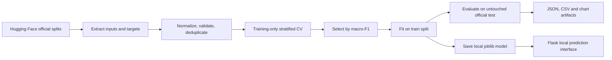

# Urdu News Intelligence System

A local, CPU-compatible Urdu news classification project with an editorial-style Flask interface. It predicts Sports (کھیل), Entertainment (تفریح), Business & Economics (کاروبار و معیشت), and Science & Technology (سائنس اور ٹیکنالوجی). It is a topic classifier, not a fact checker.

## Abstract and problem

Urdu news is difficult to route consistently because of spelling variation, morphology, and limited language tooling. This project extracts article text from Urdu instruction prompts and compares classical machine-learning baselines using word and character TF-IDF representations. Model selection uses training-only stratified cross-validation; the official test split is held back for final evaluation.

## Dataset and attribution

Source: [AhmadMustafa/Urdu-Instruct-News-Category-Classification](https://huggingface.co/datasets/AhmadMustafa/Urdu-Instruct-News-Category-Classification). The card states 100,674 train and 11,187 test examples, with `inputs`, `targets`, `template_id`, and `template_lang` columns. The prompt formats use `پیراگراف:` or `جملے:`; target completions wrap one of the four labels. Dataset-card counts are source claims; parsed counts and metrics appear only after a local run.

The card credits Khalid Hussain, Nimra Mughal, Irfan Ali, Saif Hassan, and Sher Muhammad Daudpota for the original dataset. No license field is displayed on the dataset card when checked for this project. Verify upstream terms before redistribution; this repository does not claim a license for the data.

## Objectives and methodology

- Normalize Unicode to NFC and whitespace without stripping Urdu letters or punctuation.
- Extract text from the verified `inputs` prompt markers and map expected `targets`; unknown labels and invalid rows are reported.
- Detect exact duplicates within each split and report them. Near-duplicate cross-split analysis remains a limitation.
- Compare Multinomial Naive Bayes, Logistic Regression, and Linear SVM with word (1–2 gram) plus character (2–5 gram) TF-IDF.
- Select by stratified cross-validation macro-F1 on training data, then evaluate the selected model once on the official test split.
- Save the model, metrics, classification report, confusion matrix, comparison results, and misclassified test examples.



## Architecture

- `src/urdu_news_intelligence/`: installable Python package containing preprocessing, prediction, evaluation, training comparison, path configuration, Flask application, templates and static assets.
- `app.py` and `train.py`: small launchers that keep the familiar commands while delegating to the package.
- `src/urdu_news_intelligence/templates/` and `static/`: Flask Jinja template and editorial CSS/JavaScript.
- `artifacts/models/`: locally trained joblib model.
- `artifacts/reports/`: evaluation JSON, comparison JSON, charts and misclassified rows.
- `tests/`: preprocessing, loading, single prediction and batch CSV tests.
- `pyproject.toml`: build/package configuration; dependency versions remain pinned in `requirements.txt`.

## Windows installation and execution

PowerShell:

```powershell
cd path\to\urdu_news_intelligence_project
py -3.11 -m venv .venv
.\.venv\Scripts\Activate.ps1
python -m pip install --upgrade pip
pip install -r requirements.txt
pip install -e .
python train.py
python app.py
```

Open `http://127.0.0.1:5000` in a browser. Flask serves the interface and local prediction API; Streamlit is not used or required.

Training downloads the Hugging Face dataset and can require substantial RAM, disk, and CPU time. To validate the workflow on a subset (do not report as full-set results):

```powershell
python train.py --max-train 12000 --max-test 3000 --cv-folds 3
```

Run unit tests with `pytest -q`. Dataset/model evaluation itself is performed by `python train.py` and requires dataset access.

## Results

Training writes `artifacts/models/urdu_news_classifier.joblib`, `artifacts/reports/evaluation_report.json`, `artifacts/reports/model_comparison.json`, `artifacts/reports/confusion_matrix.png`, and `artifacts/reports/misclassified.csv`. The project currently contains a previously generated local model and legacy report; the report does not identify the model or include cross-validation comparison metadata. Run the current `python train.py` workflow to regenerate complete artifacts before using those outputs as final comparative results.

## Concepts for viva

- **TF-IDF:** weights terms by their importance in one document relative to the corpus. Word n-grams capture tokens and phrases; character n-grams tolerate spelling variation.
- **Naive Bayes:** estimates class likelihoods from feature counts under a simplifying conditional-independence assumption.
- **Logistic Regression:** learns class decision boundaries and outputs class probability estimates (not automatically calibrated).
- **SVM:** finds a margin-maximizing separating boundary; Linear SVM decision values are scores, not probabilities.
- **Precision:** correct positive predictions divided by all positive predictions.
- **Recall:** correct positive predictions divided by all actual positives.
- **F1:** harmonic mean of precision and recall; macro-F1 gives each class equal weight.
- **Confusion matrix:** table of true labels against predicted labels, exposing which categories are confused.

### Sample demonstration script

1. Introduce the four categories and dataset origin.
2. Explain that prompts are parsed and model selection occurs only inside training cross-validation.
3. Paste a short Urdu sports or business article and inspect the predicted label and scores.
4. Open Dataset Explorer to show parsed counts and category balance after training.
5. Open Model Performance to explain macro-F1 and confusion-matrix errors.
6. Describe the batch CSV workflow from the training/prediction modules; the current Flask interface focuses on single article classification.
7. Close by describing limitations: four classes, possible duplicates, domain shift, and uncalibrated model scores.

### Possible viva questions

1. **Why character TF-IDF?** It can capture Urdu subword patterns and tolerate some spelling variation.
2. **Why macro-F1 for selection?** It weighs each class equally, even if class counts differ.
3. **Why keep the test split untouched?** To estimate generalization without using test results to choose model settings.
4. **Why normalize Unicode?** Visually equivalent text may have different code-point sequences.
5. **What does the confusion matrix reveal?** Which true categories are most often assigned another label.
6. **Are output scores probabilities?** Only models exposing `predict_proba` return probability estimates; even those may not be calibrated.

## Limitations and future improvements

Only four labels are supported; text outside the dataset domain is still forced into one. Urdu code switching, short inputs, spelling variation, and source bias can reduce performance. Exact duplicates are removed within each split; near-duplicate leakage across splits has not been audited. Scores are not calibrated confidence, and the app does not verify factual accuracy. Future work includes leakage analysis, error taxonomy, calibration, broader labels, and optional XLM-R experiments.
